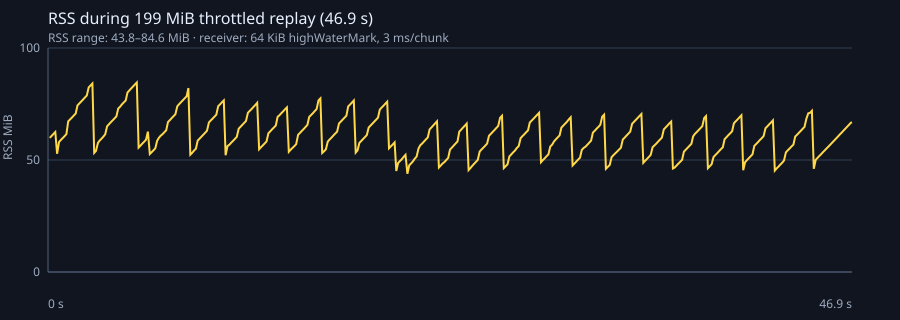

# Dogfight — Лабораторна 4: Node.js, WebSocket і потоки

Лаба продовжує браузерну гру з [лаби 3](https://github.com/dwysuxx/dogfight/tree/lab03) і переносить lobby на справжній Node.js HTTP/WebSocket сервер. Сервер керує кімнатами та чатом, а файлові журнали пише й віддає потоками з backpressure. Стан симуляції не синхронізується між клієнтами: це тема лабораторної 5.

## Вимоги й запуск

Потрібен Node.js 22 або новіший.

```powershell
npm ci
Copy-Item .env.example .env   # необов'язково: значення за замовчуванням уже працюють
npm run build
npm start
```

Відкрийте `http://127.0.0.1:3000`. Для розробки запустіть у двох терміналах `npm run dev` (Node API/WebSocket) і `npm run dev:client` (Vite, за замовчуванням `http://localhost:5173`). Vite проксить `/api` і `/ws` на сервер.

`npm test` запускає тести клієнта й сервера; `npm run lint` перевіряє обидва пакети; `npm run build` збирає браузерний клієнт у `client/dist`. Конфігурація: `HOST`, `PORT`, `LOG_DIR`, `MAX_ROOMS`, `MAX_PLAYERS_PER_ROOM`, `MAX_PAYLOAD`, `MAX_MESSAGES_PER_SECOND`, `SLOW_CLIENT_BYTES`, `JOIN_TIMEOUT_MS`, `HEARTBEAT_MS`. Значення перевіряються при старті. `Ctrl+C` або `SIGTERM` зупиняє приймання з'єднань, закриває WebSocket і дописує журнали.

## Структура

```text
client/                       Vite-клієнт із попередніх лабораторних
  src/connection.js           WebSocket: черга, join, reconnect із backoff
  src/lobby/                  HTTP lobby та незалежний DOM-рендеринг
  vite.config.js              dev proxy /api і /ws
server/
  src/index.js                запуск, конфігурація, graceful shutdown
  src/config.js               перевірка environment
  src/http.js                 node:http, API і безпечна роздача dist
  src/protocol.js             версія 0 JSON-протоколу і валідація
  src/rooms.js                Room/RoomManager на EventEmitter
  src/ws.js                   lifecycle, heartbeat, rate і slow-client policy
  src/log/matchlog.js         object-mode Transform і pipeline до NDJSON
  src/log/replay.js           async iterator для incremental replay
  src/log/benchmark.js        200 MiB throttled-stream RSS benchmark
server/test/                  node:test: HTTP, WebSocket, rooms, replay
```

Кореневий `package.json` оголошує npm workspaces `client` і `server`; код використовує ESM та `node:`-префікси для вбудованих модулів.

## HTTP, кімнати та протокол

- `GET /health` — статус процесу; `GET /api/rooms` — кімнати, місткість і конфігурація арени; `POST /api/rooms` — створює кімнату з JSON `{ "name": "Practice", "arena": { "width": 960, "height": 540, "asteroids": 6 } }`. Тіло має обмеження `MAX_PAYLOAD`; некоректні запити отримують 4xx.
- У production `node:http` роздає `client/dist` із MIME-типами, `realpath`-перевіркою symlink і захистом від path traversal. `/api/replays/:id` — окремий маршрут для журналів, а невідомий `/api/...` не маскується SPA fallback-ом.
- `Room extends EventEmitter`: `join`, `leave`, `chat`, `empty` і структуровані `event` для журналу. `RoomManager` лімітує кількість кімнат/гравців та видаляє кімнату після виходу останнього гравця.
- WebSocket endpoint: `/ws`. Усі вхідні повідомлення — JSON з `v: 0`: `{ "v": 0, "type": "join", "room": "orbit", "name": "Ada" }` або `{ "v": 0, "type": "chat", "text": "Hi!" }`. Сервер перевіряє версію, тип, форму, додаткові поля та довжину рядків; oversize frame закривається `1009`, порушення протоколу — `1002`/`1008`.
- Клієнт має надіслати `join` за 5 секунд. Сервер повертає `joined`, оновлює `roster` і ретранслює чат. Ping/pong перевіряє живість сокетів; token bucket обмежує повідомлення, а повільному клієнту не відправляється chat при переповненому `bufferedAmount` (для критичного roster з'єднання закривається).
- `client/src/connection.js` повторно підключається з експоненційною затримкою, повторює join та тримає обмежену чергу повідомлень під час `CONNECTING`.

Перевірка вручну: запустіть сервер та дві вкладки, введіть різні імена, приєднайтесь до однієї кімнати й надішліть чат. Обидві вкладки отримають той самий roster і повідомлення. Для API можна використати `curl.exe http://127.0.0.1:3000/api/rooms` та POST з JSON body.

## Match logs, streams і backpressure

Кожна кімната пише події в `server/logs/<room>-<timestamp>-<id>.ndjson`. `MatchLogTransform` працює в object mode і перетворює події в NDJSON; `pipeline` передає їх до `createWriteStream`, поширює помилки та застосовує backpressure до файлового writable. Оскільки `EventEmitter.emit()` синхронний і не вміє чекати `drain`, адаптер призупиняє подачу в stream та тримає не більше 4096 pending events; якщо черга переповниться, log pipeline завершується явною помилкою замість необмеженого росту RAM.

`GET /api/replays` повертає список, `GET /api/replays/:id` передає файл через `pipeline(createReadStream, response)` — replay не завантажується цілком у пам'ять. `server/src/log/replay.js` також читає NDJSON рядок за рядком через async iterator.

Щоб відтворити вимірювання потоку приблизно 200 MiB у slow consumer і згенерувати графік:

```powershell
npm run benchmark
```

Скрипт створює тимчасовий NDJSON replay потоком, віддає його локальному HTTP-клієнту зі штучним throttling, знімає `process.memoryUsage().rss` кожні 100 мс, зберігає графік у [server/docs/backpressure-rss.svg](server/docs/backpressure-rss.svg) і видаляє тимчасовий replay. Розмір receive buffer — 64 KiB. Обсяг фактичних байтів і RSS min/max друкуються в консолі; результат залежить від ОС і машини.



`writable.write(chunk) === false` означає, що writable досяг high-water mark: це сигнал припинити подачу до `drain`, а не помилка запису. `pipeline` з'єднує readable, transform і writable та координує backpressure й cleanup; цикл, що ігнорує false, накопичує буфери в RAM. TCP і WebSocket мають ту саму проблему повільного споживача: вимірюйте `bufferedAmount`, обмежуйте чергу, відкидайте необов'язкові дані або закривайте з'єднання.

## Event loop: блокування та обробка помилок

libuv проходить фази timers → pending callbacks → poll (I/O) → check (`setImmediate`) → close callbacks; між callback-ами Node спорожнює чергу `process.nextTick`, потім promise microtasks. У головному модулі порядок `setTimeout(fn, 0)` та `setImmediate(fn)` може відрізнятися залежно від часу входу в loop; всередині I/O callback `setImmediate` виконується у check-фазі перед наступним timers. `process.nextTick` не є фазою і здатний голодувати I/O, якщо безмежно додавати callback-и.

JavaScript у процесі виконується одним потоком. Для демонстрації запустіть дві вкладки в одній кімнаті та:

1. У першій викличте `fetch("/api/slow?ms=300")` із DevTools або відкрийте URL окремо.
2. Одразу надішліть chat у другій вкладці.
3. Chat з'явиться після завершення повного синхронного циклу на 300 мс — один handler затримав HTTP, WebSocket, таймери та всіх інших клієнтів.

`/api/slow` навмисно блокує event loop лише для цього локального досліду; параметр обмежений 1–1000 мс і не використовується грою. У нормальному handler-і треба ділити CPU-роботу на порції або віддати її worker thread, а I/O — очікувати асинхронно.

Події `EventEmitter` викликають слухачів синхронно у порядку підписки. `error` без слухача спеціально кидає виняток і завершує процес; тому HTTP/WebSocket/room/log emitters мають явно обробляти помилки. Аналогічно не можна губити rejected promise: Node за типовою конфігурацією перетворює необроблений rejection на помилку процесу.

```text
$ node --input-type=module -e "Promise.reject(new Error('disk failed'))"
node:internal/process/promises:...
Error: disk failed
```

Для серверного коду перехоплюйте відому операцію (`try/catch` або `.catch`) і логгуйте контекст; глобальний `unhandledRejection` у `server/src/index.js` — лише остання лінія оборони, що ініціює shutdown, а не спосіб приховати помилку.

## Node REPL експерименти

```js
import { EventEmitter } from "node:events";
import { Readable, Writable } from "node:stream";
import { pipeline } from "node:stream/promises";

console.log(Buffer.from("привіт").length, "привіт".length); // bytes vs UTF-16 code units
console.log(Buffer.from([0xff, 0x00]).readUInt16BE(0)); // 65280

const source = Readable.from((function* () {
  for (let i = 0; i < 100; i++) yield Buffer.alloc(64 * 1024);
})());
const slow = new Writable({
  write(_chunk, _encoding, callback) { setTimeout(callback, 10); },
});
await pipeline(source, slow);

const emitter = new EventEmitter();
emitter.on("error", (error) => console.error("handled:", error.message));
emitter.emit("error", new Error("disk unavailable"));
```

CommonJS (`require`, `module.exports`) і ESM (`import`, `export`) — різні формати модулів; цей workspace оголошує `"type": "module"`. У ESM немає `__dirname`; використовуйте `import.meta.url` разом із `fileURLToPath` або сучасний `import.meta.dirname`.

## Межі цього етапу

WebSocket передає lobby/roster/chat, але не позиції чи snapshot гри. Збереження NDJSON/replay потокове; 200 MiB benchmark — штучний синтетичний log, а не реальний матч. Binary protocol, синхронізація симуляції та production TLS/authentication не входять у лабораторну 4.
