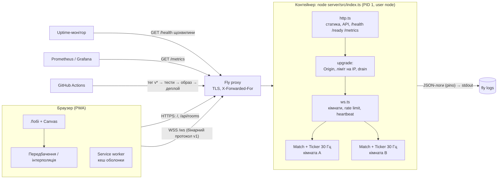
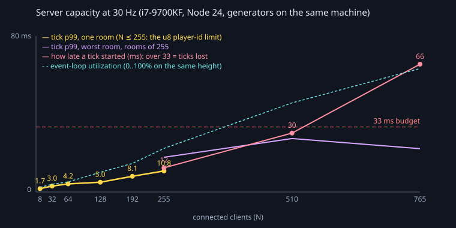

# Dogfight — космічні дуелі в браузері

[](https://github.com/dwysuxx/dogfight/actions/workflows/ci.yml)
[](https://github.com/dwysuxx/dogfight/actions/workflows/deploy.yml)

**▶ Грати: https://dogfight-dwysuxx.fly.dev** · встановлюється як застосунок (PWA) · до 16 пілотів у кімнаті

<!-- GIF / демо-відео: запишіть 20–30 с матчу двох віддалених гравців, збережіть як docs/demo.gif
     (або посилання на відео) і розкоментуйте рядок нижче. -->
<!--  -->

Багатокористувацька аркада: кораблі, кулі, астероїди, підсилення. Сервер авторитетний (30 Гц), клієнт передбачає свій корабель і плавно інтерполює чужі, тож гра відчувається миттєвою навіть при 100 мс пінгу. Створіть свою кімнату, киньте друзям посилання, додайте ботів, якщо друзів немає.

**Керування:** <kbd>←</kbd><kbd>→</kbd>/<kbd>A</kbd><kbd>D</kbd> поворот · <kbd>↑</kbd>/<kbd>W</kbd> тяга · <kbd>Space</kbd> вогонь · <kbd>M</kbd> звук · <kbd>N</kbd> netgraph · <kbd>L</kbd> штучний лаг

## Лабораторна 8: Ship It

Лаба 8 переносить гру з localhost на публічну адресу. Код попередніх лаб описано нижче, від [лаби 7](#лабораторна-7-рушій-память-і-тести).

### Архітектура



Стан матчів живе в пам'яті одного процесу. Тому один інстанс: `auto_stop_machines = "off"`, `min_machines_running = 1`. Чому саме так, див. відповідь 2 нижче.

### Запуск

```powershell
npm ci
npm run build && npm start             # http://127.0.0.1:3000
docker compose up --build              # той самий образ, що в продакшені: http://localhost:3000
```

| Команда | Що робить |
|---|---|
| `npm run check` | typecheck → lint → тести з покриттям (у CI ще build і e2e) |
| `npm test` | Vitest: 115 тестів, серед них chaos-тести і тести продакшен-процесу |
| `npm run e2e` | Playwright: два браузери, створення своєї кімнати, PWA, `/health` |
| `npm run bench:load` | навантажувальний тест (лаба 7) |
| `npm run docker:build` | локальна збірка образу |
| `node client/scripts/make-icons.ts` | перегенерувати PNG-іконки PWA |

### M1 — продакшен-процес

| Вимога | Як зроблено |
|---|---|
| `PORT`, `0.0.0.0` | `HOST`/`PORT` з оточення; в образі `HOST=0.0.0.0 PORT=8080` |
| Graceful shutdown < 10 с | `SIGTERM` → `/ready` = 503 і нові сокети отримують 503 → гравцям `1001 going away` (клієнт сам перепідключиться) → дописати match-логи → вихід 0. Жорсткий таймер `SHUTDOWN_TIMEOUT_MS = 8 с` спрацьовує до `kill_timeout = 10 с` у Fly. Тест: закриття з гравцем у кімнаті триває < 2 с, гравець отримує 1001 |
| `/health` і `/ready` | `/health` (liveness): процес відповідає, плюс версія, коміт, uptime. `/ready` (readiness): 503 під час drain або без збірки клієнта; саме на нього дивиться health-check Fly |
| Падіння на невідомих помилках | `uncaughtException` / `unhandledRejection` → `fatal`-лог зі стеком → спроба попрощатися з гравцями → exit 1, платформа перезапускає чистий процес. Невалідний конфіг → `fatal` і exit 1 ще до `listen` |
| Логи pino | JSON у stdout; кожен рядок клієнта має `connectionId`, `ip`, після входу ще `roomId`, `playerId` (child logger). Тексту чату в логах немає, лише довжина |
| `/metrics` | Формат Prometheus, без залежностей (`server/src/metrics.ts`): з'єднання, матчі, гравці, повідомлення й байти в/з, p95 тіку і overruns по кімнатах, відмови апгрейду за причинами, кіки за причинами, падіння матчів, HTTP за класами статусу, RSS, heap, ELU, `dogfight_build_info{version,commit}`. Опційно захищається `METRICS_TOKEN` |
| Версія | `APP_VERSION`/`GIT_SHA` — build-args з git-тегу; локально береться `package.json` (1.0.0). Видно в `/health`, `/metrics` і в кожному рядку логу |
| Валідація конфігу | Одна zod-схема (`server/src/config.ts`), нові поля: `LOG_LEVEL`, `ALLOWED_ORIGINS` (тільки справжні origin), `MAX_CONNECTIONS`, `MAX_CONNECTIONS_PER_IP`, `TRUST_PROXY`, `SHUTDOWN_TIMEOUT_MS`, `ROOM_IDLE_MS`, `METRICS_TOKEN`. Див. `.env.example` |

Приклад рядка логу:

```json
{"level":"info","time":"2026-10-29T12:16:33.262Z","service":"dogfight","version":"1.0.0","connectionId":"14f7…","ip":"127.0.0.1","roomId":"9c6aba70","playerId":"14f7…","name":"Pilot","codec":"json","msg":"player joined"}
```

### M2 — захист

- **Origin.** CORS не стосується WebSocket, тому `upgrade` перевіряє `Origin` сам. Пропускає той самий host і список `ALLOWED_ORIGINS` (наприклад, `https://html-classic.itch.zone`), чужий сайт отримує 403. Запит без `Origin` пропускається: браузер його завжди надсилає, а бот чи load-тест може підробити будь-який заголовок, тож від них захищають ліміти, а не Origin.
- **Ліміти з'єднань.** `MAX_CONNECTIONS_PER_IP = 8` → 429, `MAX_CONNECTIONS = 1000` → 503. Лічильник збільшується ще на апгрейді, тож шквал рукостискань не проскочить. За проксі IP береться з **останнього** хопа `X-Forwarded-For` (лише з `TRUST_PROXY=true`), бо попередні хопи пише сам клієнт. Ліміти з лаби 5 лишились: розмір кадру, token bucket 60 повідомлень/с, таймаут входу, heartbeat 15 с, відсікання повільних клієнтів.
- **Кімнати.** Знайдено під час лаби: «Orbit» і «Deep Field» **зникали** після виходу останнього гравця, а створені й ніким не зайняті кімнати **не видалялись ніколи**, тож циклом POST можна було заповнити `MAX_ROOMS`. Тепер вбудовані кімнати постійні, а кімнати гравців видаляються через `ROOM_IDLE_MS` (60 с) порожнечі. Гравець, що перезавантажив сторінку, свою кімнату ще знайде.
- **Ізоляція кімнат.** Виняток у тіку однієї кімнати раніше валив весь процес. Тепер `failRoom` закриває лише цю кімнату (`1011`), пише лог і рахує `dogfight_room_failures_total`. Виняток в обробнику повідомлення закриває лише того клієнта.
- **Баг лобі «Could not create room».** У браузері створення кімнати завжди падало з `Failed to execute 'fetch' on 'Window': Illegal invocation`. `Lobby` зберігав нативний `fetch` у полі й викликав його як `this.fetchImpl(...)`, тобто з `this = lobby`. Виправлено обгорткою `(input, init) => fetch(input, init)`; регресійні тести є в `client/test/lobby.test.ts` і `e2e/ship-it.spec.ts`.

**Chaos-тести** (`server/test/chaos.test.ts`, `client/test/reconnect.test.ts`). Метрика ізоляції: найдовша пауза між snapshot у гравця **іншої** кімнати, поки ламається перша (норма — 33 мс, поріг тесту — 250 мс).

| Сценарій | Що відбувається | Інша кімната |
|---|---|---|
| Клієнт убито без close-кадру (`terminate`, як закрита вкладка чи втрачений Wi-Fi) | гравця прибрано, сусід по кімнаті отримує новий roster | грає без пауз |
| Флуд 2000 сміттєвих кадрів (випадкові байти, текст і бінарні) | відправника відключено з 1002/1008 після першого ж кадру, `dogfight_ws_kicked_total` росте, `/health` = 200 | грає без пауз |
| Баг у симуляції (`Match.step` кидає виняток в «Orbit») | гравці Orbit отримують `internal-error` і 1011, процес живий | грає без пауз; Orbit знову доступна |
| Сервер убито й піднято на тій самій адресі | справжній `GameConnection` бачить 1001, робить backoff, перепідключається і **сам** заходить у ту саму кімнату | — |

**Перевірені ліміти навантаження** (лаба 7, `npm run bench:load`, 8-ядерна машина): одна кімната — до 255 гравців (межа u8 у протоколі), процес — **~510 клієнтів** при 30 Гц (тік p99 27 мс, ELU 57%). При 765 тіки запізнюються на два інтервали. Вузьке місце на справжньому сервері — **смуга**: 131 MB/s при 510 клієнтах у кімнатах по 255. Тому `MAX_PLAYERS_PER_ROOM = 16`, а `hard_limit` у Fly — 900 з'єднань.

### M3 — контейнер і пайплайн

- **`Dockerfile`**, чотири стадії: `deps` (усі залежності, кешуються до зміни маніфестів) → `build` (`vite build`) → `prod-deps` (`npm ci --omit=dev`: ws, zod, pino) → `runtime` на `node:24-alpine`. Без npm/corepack/yarn (~20 MB), користувач `node`, exec-form `CMD ["node", "server/src/index.ts"]`, `HEALTHCHECK` через вбудований `fetch`, `STOPSIGNAL SIGTERM`. TypeScript сервера компілювати не треба: Node 24 стирає типи сам (`erasableSyntaxOnly`), тож у контейнері працює той самий код, що пройшов `tsc`.
- **`.dockerignore`**: у контекст не потрапляють `node_modules`, `.git`, `.env`, тести, бенчмарки, логи.
- **`compose.yaml`**: той самий образ локально, `stop_grace_period: 10s`, read-only FS, том для match-логів.
- **`.github/workflows/deploy.yml`**: тег `v*` → повний CI (typecheck, lint, покриття, e2e) як reusable workflow → образ з build-args версії в GHCR і в реєстр Fly → **перевірка, що образ < 200 MB** → `flyctl deploy` → smoke-тест живої адреси: `/health` повертає версію тегу, `/ready` = 200, рукостискання **WSS** через проксі Fly = 101.
- **`fly.toml`**: регіон `waw`, `kill_timeout = 10`, `TRUST_PROXY=true`, check на `/ready`, одна машина, що не засинає.

**Розгортання з нуля** (один раз):

```bash
fly auth login
fly apps create dogfight-dwysuxx           # ім'я = app у fly.toml
fly tokens create deploy -x 999999h        # → GitHub: Settings → Secrets → FLY_API_TOKEN
# GitHub: Settings → Variables → FLY_APP = dogfight-dwysuxx
fly deploy                                 # перший деплой вручну, далі лише теги:
git tag v1.0.0 && git push origin v1.0.0
```

### M4 — запуск

| Що | Статус |
|---|---|
| Два віддалені гравці дограли матч | ☐ заповнити: хто, звідки, RTT з netgraph (<kbd>N</kbd>) |
| Uptime-монітор | ☐ UptimeRobot / Better Stack: `GET https://dogfight-dwysuxx.fly.dev/health`, раз на хвилину, сповіщення в Telegram/e-mail |
| PWA | ✅ `manifest.webmanifest`, іконки 192/512 + maskable, service worker (мережа першою для сторінки, кеш з фоновим оновленням для решти, `/api` і `/ws` не кешуються). e2e перевіряє маніфест і активний SW. ☐ Встановити з Chrome на телефоні й ПК |
| README, демо, тег | ✅ README; ☐ GIF/відео; ☐ `git tag lab-08 v1.0.0` |

**Заміри (заповнити після деплою):**

| Гравець | Місто → регіон Fly | RTT p50 | RTT p95 | Втрати |
|---|---|---|---|---|
| A | … → waw | … мс | … мс | … % |
| B | … → waw | … мс | … мс | … % |

| Образ | Розмір |
|---|---|
| `ghcr.io/dwysuxx/dogfight:v1.0.0` | … MB (CI падає, якщо ≥ 200 MB) |

### Обмеження

- **Один процес.** Матчі в пам'яті: деплой рве матчі (гравці перепідключаються за кілька секунд, але матч починається спочатку), горизонтального масштабування немає.
- **Match-логи на ефемерному диску** машини Fly: реплеї зникають з деплоєм (у compose вони на томі).
- **Без акаунтів і античиту**, крім авторитетного сервера: ім'я пілота може бути будь-яким, ліміт на IP обходиться кількома адресами.
- **Смуга** росте як N² у кімнаті: великі кімнати дорогі. Delta-стиснення snapshot ще не зроблено.
- `/metrics` без токена відкритий; на публічному сервері треба задати `METRICS_TOKEN` через `fly secrets set`.

### Що я зробив би далі

1. Delta-стиснення snapshot (відносно останнього підтвердженого `ack`): ~3–5× менше трафіку, отже більше кімнат на ту саму смугу.
2. Два інстанси з прив'язкою кімнати до машини (`fly-replay` за `roomId`) замість Redis pub/sub: кімната все одно живе в одному процесі, тож маршрутизувати треба вхід, а не кожен кадр.
3. Sentry для клієнтських помилок (серверні вже в JSON-логах).
4. Перенесення стану матчу під час деплою: drain чекає кінця раунду, а не рве його.
5. Посилання-запрошення в кімнату (`/?room=abc123`) і приватні кімнати з кодом.

### Відповіді для дошки (лаба 8)

1. **Послідовність завершення і чому `CMD npm start` її ламає.** `SIGTERM` → readiness off (Fly перестає слати трафік) → нові апгрейди отримують 503 → гравцям `1001` → закрити WSS і HTTP (`closeIdleConnections`, інакше keep-alive тримає `server.close`) → дописати логи → exit 0, і все це до `kill_timeout`. Із `npm start` PID 1 — npm (або `sh`): він не пересилає сигнал дочірньому `node` чи робить це ненадійно, тож Node `SIGTERM` не бачить, а через 10 с усе вбиває `SIGKILL`: матчі обриваються без 1001, логи не дописані. Exec-form робить `node` процесом PID 1, і сигнал отримує наш обробник.
2. **Масштабування WebSocket проти REST.** REST без стану: будь-який запит на будь-який інстанс, балансувальник round-robin. WebSocket має стан (кімната, матч, з'єднання в пам'яті), і з'єднання довге. Варіанти: (а) один інстанс; (б) sticky-маршрутизація, де вся кімната живе на одному інстансі, а маршрутизується вхід; (в) Redis pub/sub між інстансами, що додає затримку на кожен кадр і не підходить для авторитетної симуляції 30 Гц. Ще одна відмінність: «легкий» деплой для REST рве всі з'єднання WebSocket.
3. **Навіщо `wss://`.** Сторінка на HTTPS не може відкрити `ws://` (mixed content). Без TLS проміжні проксі й мобільні оператори ламають `Upgrade` і можуть читати чи підміняти кадри. TLS закінчується на проксі Fly, до процесу йде звичайний `ws` у приватній мережі.
4. **Чому CORS не захищає WebSocket.** CORS — це правило браузера для читання відповідей `fetch`/XHR. Апгрейд WebSocket під нього не підпадає: будь-який сайт може відкрити сокет до нас, і браузер додасть кукі (cross-site WebSocket hijacking). Захищає лише перевірка `Origin` на сервері, плюс ліміти для не-браузерних клієнтів, які `Origin` підробляють.
5. **Liveness проти readiness.** Liveness (`/health`) питає «процес живий?»; провал означає «перезапусти мене». Readiness (`/ready`) питає «чи слати мені гравців?»; провал означає «не маршрутизуй, але не вбивай». Під час drain процес живий, але не готовий. Якби платформа дивилась на `/health`, вона або слала б гравців у сервер, що закривається, або вбила б його, не давши попрощатися.
6. **Порядок шарів Docker.** Шар перебудовується, якщо змінився він або будь-який шар над ним. Тому спочатку маніфести і `npm ci` (змінюються рідко), потім код. Зміна одного `.ts` не перевстановлює залежності, і збірка йде секунди, а не хвилини. У runtime теж: `node_modules` → `shared` → `server` → `client/dist`.
7. **Як я дізнаюсь про падіння о 3-й ночі.** Uptime-монітор на `/health` пише в Telegram, якщо дві перевірки поспіль провалені. Платформа перезапускає процес, `fatal`-лог зі стеком лишається в `fly logs`. `dogfight_room_failures_total` і `process_uptime_seconds`, що скинувся, видно в метриках. Вранці: `fly logs | jq 'select(.level=="fatal")'`.
8. **Скільки гравців з Європи витримає сервер.** Виміряно ~510 клієнтів на процес на 8-ядерній машині при ELU 57%. Тік однопотоковий, але `shared-cpu-1x` повільніший і ділить CPU, тому закладаю запас ×2–3: **~150–250 одночасних гравців** на одній машині. Смуга при кімнатах по 8: ~12 KB/s на гравця, тобто ~3 MB/s на 250 гравців, і це не межа. RTT з регіону `waw` до більшості Європи — 20–60 мс, що вкладається в буфер інтерполяції ~100 мс. За законом Літтла (одночасних = прибуття × тривалість сесії) при сесіях по 15 хв 200 одночасних гравців — це ~800 сесій на годину. Для курсового проєкту запас великий. Першим зламається CPU на shared-ядрі, тому перший крок — `performance-1x`.

### Stretch

Не зроблено: два інстанси, Redis, Sentry, постмортем. Що для цього вже готово: `/ready` і drain (потрібні для rolling-деплою двох машин), `dogfight_build_info` (видно, яка версія на якій машині), `roomId` у кожному рядку логу (основа для маршрутизації кімнат).

---

# Лабораторна 7: рушій, пам'ять і тести

> **GIF двох гравців:** запишіть 20 секунд двох вікон поруч (`?lag=50&jitter=30&drop=0.02`), збережіть як `docs/lab-05-two-players.gif` і розкоментуйте рядок нижче.
<!--  -->

Лаба продовжує [лабу 6](https://github.com/dwysuxx/dogfight/tree/lab06), де весь код на TypeScript. Тут чотири частини:
- **набір тестів:** Vitest, fast-check і Playwright з двома браузерами, усе в CI;
- **профілювання і менше сміття** в клієнтському й серверному циклі;
- **серверні боти** з тим самим вводом, що й у людей;
- **експеримент із Web Worker** і **навантажувальний тест** із графіком місткості.

## Запуск і перевірки

Потрібен Node.js 22.18+.

```powershell
npm ci
npm run build && npm start          # http://127.0.0.1:3000
```

| Команда | Що робить |
|---|---|
| `npm test` | Vitest: проєкти `shared`, `server`, `client` (101 тест, з них 7 property-тестів fast-check) |
| `npm run coverage` | те саме з покриттям; поріг для `shared/`: 85% |
| `npm run e2e` | Playwright: збирає клієнт, піднімає сервер, грають два браузери |
| `npm run typecheck` / `npm run lint` | tsc для всіх пакетів, `bench/`, `e2e/` і конфігів; ESLint із правилами, що читають типи |
| `npm run check` | typecheck → lint → coverage |
| `npm run bench:frame` | бенчмарк кадру клієнта й тіку сервера (8 ботів, 30 с гри) |
| `npm run bench:load` | навантажувальний тест і графік `server/docs/load-test.svg` |
| `npm run bench:worker` | експеримент «декодування snapshot у Worker» |
| `POST /api/rooms/:id/bots {"count": 8}` | додати серверних ботів у кімнату; `DELETE` прибирає їх |

**Сторінка:** `?perf=1` вмикає `performance.mark/measure` для `simulate`, `render`, `decode`, `reconcile` (видно на доріжці *Timings* у DevTools → Performance). Netgraph тепер показує p50/p95/p99 часу кадру, як інтервалу між кадрами, так і нашого JavaScript.

## M1 — тести

- **Vitest** на всі три пакети одним `vitest.config.ts` (`test.projects`): 101 тест.
- **Юніт-тести:**
  - `Vector2`;
  - випадки зіткнень: дотик, перекриття, промах, тунелювання;
  - детермінізм `World.step`;
  - **reconciliation як чиста функція** `replay(snapshot, pending)`, винесена з `Predictor`;
  - **token bucket** (`server/src/rate-limit.ts`);
  - **heartbeat** (`server/src/heartbeat.ts`) і **цикл з акумулятором**: обидва на фальшивих таймерах (`vi.useFakeTimers`); цикл приймає `requestFrame`, щоб його можна було тестувати без rAF;
  - боти, кеш рендера та всі тести з попередніх лаб.
- **Тунелювання.** На найбільшій швидкості зближення в грі (840 px/с = 28 px за крок) куля **не** пролітає крізь корабель, бо разом вони займають 30 px. Приблизно вдвічі швидша куля (1800 px/с) вже пролітає. Це межа дискретних зіткнень, і тест її документує.
- **fast-check, 7 властивостей** (`shared/test/properties.test.ts`):
  1. бінарний STATE: `decode(encode(m)) ≈ m` у межах квантування для **будь-якого** згенерованого snapshot;
  2. довжина закодованого кадру рівно така, як у письмовій специфікації;
  3. INPUT проходить туди й назад точно;
  4. довільне сміття (2000 випадкових буферів + правдоподібні заголовки) ніколи не кидає виняток, а повертає типізовану помилку;
  5. snapshot з одним зміненим байтом розбирається або відхиляється, але не падає;
  6. `parseClientMessage` приймає кожне валідне повідомлення й відхиляє кожну його мутацію: зайве поле, видалене поле, поле не того типу, інша версія;
  7. кораблі лишаються в межах арени за 1000 випадкових кроків вводу; окремо — два світи з одним seed не розходяться.
- **Покриття `shared/`:** 98% рядків, 96% інструкцій, 88% гілок (поріг 85% закладено в конфіг, CI падає нижче нього).

**Що знайшли тести:**
- **Корабель на мить вилітав за межі арени.** Властивість «кораблі в межах арени» зловила це на seed 11, крок 879. Перенесення через край (`wrapAround`) виконується в `Ship.update`, а виштовхування від астероїда (`shift`) відбувається пізніше в тому ж кроці й могло виштовхнути корабель за шов. Виправлено: після виштовхування корабель переноситься знову (`shared/sim/rules.ts`). Еталонний хеш `313ef01b` не змінився, бо еталонний сценарій у цей край не потрапляє.
- **Матч міг замерзнути.** Понад 255 подій за тік (u8-лічильник) кидали `RangeError` прямо в тікері сервера, і після цього наступні тіки вже не плануються. Це знайшов експеримент із Worker. Тепер кодек надсилає перші 255 подій (вони косметичні), а тест закріплює цю поведінку.

## M2 — e2e, CI, лінт за типами

- **Playwright** (`e2e/two-players.spec.ts`, `playwright.config.ts` з `webServer`): збирається продакшн-клієнт, піднімається справжній сервер, і два контексти браузера заходять в Orbit.
  - Перевіряється roster в обох вікнах.
  - Ada тримає `↑`, а Lin **бачить рух корабля Ada менш ніж за 500 мс** (за snapshots у вікні Lin).
  - Чат доходить.
  - Окремий тест: кнопка звуку, клавіша `M` і те, що вибір запам'ятовується після перезавантаження.
  - Тести читають стан гри через невеликий хук `window.dogfight.state()` (`client/src/debug.ts`).
- **CI** (`.github/workflows/ci.yml`): `npm ci` (кеш за `package-lock.json`) → typecheck → lint → unit + coverage → build → `playwright install --with-deps chromium` → e2e. Якщо e2e падає, звіт Playwright зберігається як артефакт. Бейдж — угорі.
- **ESLint `recommendedTypeChecked`** + `no-floating-promises`. Кілька знахідок:
  - `prefer-promise-reject-errors`: `abortError` повертав `unknown` → тепер завжди `Error`;
  - `require-await`: генератор у бенчмарку був `async` без потреби;
  - **`unbound-method` знайшов рівно всі місця з «багом `this`» з лаби 2** (демо й тест, що відтворюють його навмисно). Там стоять явні винятки з поясненням.
- `.gitattributes` з `eol=lf`: після злиття git із `autocrlf` перетворював файли на CRLF, і через це правки «тихо» не застосовувались.

## M3 — профілювання: що виміряно і що змінено

**Як міряли.** Записати панель Performance у Chrome й зробити скріншоти flame chart в цьому середовищі неможливо. Тому `bench/frame-bench.ts` проганяє **справжній клієнтський код** проти **справжнього серверного `Match`** у Node (той самий V8): `GameSession` (decode, reconcile, інтерполяція), `renderables` + `drawEntity` у порожній canvas-контекст, `hudState`.
- **Сценарій:** 8 ботів, гравець, що стріляє без перерви, 10 астероїдів; 30 с гри при 60 fps / 30 Hz після 2 с розігріву.
- **GC:** паузи рахує `PerformanceObserver("gc")`, окремо major і minor.
- **Профілі.** Алокатори — з сэмплінгу купи з урахуванням **уже зібраних** об'єктів (звичайний `--heap-prof` показує лише те, що живе в кінці, тобто ховає сміття кожного кадру). Гарячі функції — з `--cpu-prof`.
- **Flame chart.** `bench/profiles/client-frame-{before,after}.cpuprofile` і `server-128-clients-60s.cpuprofile` відкриваються в DevTools (Performance → Load profile).
- **Що не виміряно.** Час малювання canvas у браузері стенд не враховує. Для нього є `?perf=1` і netgraph.

Середовище: Windows 10, i7-9700KF, Node 24.20. Кожен рядок — 3 прогони (діапазон).

| 30 с гри, 8 ботів | **До** | **Після** |
|---|---|---|
| JS-робота кадру клієнта p50 / p95 / p99 | 0,069 / 0,16 / 0,24–0,35 мс | 0,051 / 0,13–0,15 / 0,20–0,24 мс |
| Тік сервера p50 / p99 | 0,082 / 0,45–0,54 мс | 0,056 / 0,22–0,38 мс |
| Алокацій за 30 с | 205–214 MiB | **78 MiB (−63%)** |
| Minor GC за 30 с (сумарна пауза) | 23 (~10 мс) | **7–8 (~6–7 мс)** |
| Minor GC за 180 с | 77 | 22 |
| **Major GC за час гри** | 0 | **0** |
| Топ-3 алокатори | об'єкти ітератора `next` (23%), частинки вибуху (12%), `Bullet.fromSnapshot` (5%) | `decodeEntity` (10%), `next` (9%), `Bullet.toSnapshot` (7%) |
| Топ-3 за власним часом CPU | `renderables`, `Match.step`, `drawEntity`/конструктор `Explosion` | `renderables`, `decodeEntity`, `drawExplosion` |

**Чесно про major GC.** Перші заміри показували «1 major за 30 с», але це була помилка мого стенда: `PerformanceObserver` доставляє записи асинхронно, і збірка з розігріву потрапляла у вікно заміру. Після виправлення (фільтр за `entry.startTime`) major GC за 30 і 180 с гри немає **ні до, ні після**. У двох із трьох прогонів «після» одна збірка припадає на секунду 0: це хвіст інкрементального маркування після старту, а не гра. Отже, ціль «нуль major GC, p99 < 16,7 мс» виконується. JS кадру займає соті частки мілісекунди: бюджет кадру з'їдає браузерне малювання, а не наш код. Оптимізації нижче дали **менше сміття**: утричі менше алокацій і minor-збірок.

**Що змінено (за спаданням виміряного ефекту):**
1. **Генератори на гарячих шляхах.** `World[Symbol.iterator]` з `yield*`, генератор `ofKind`, генератор `findCollisions`, `predictor.entities()` створювали об'єкт-результат ітератора **на кожен елемент**: 23% усіх алокацій. Тепер `World` тримає щільний масив у порядку вставки (той самий порядок, що в `Map`, тож детермінізм збережено, хеш `313ef01b`). Зіткнення передаються через visitor-колбек, гарячі цикли індексні, а `Map` обходиться через `forEach`.
2. **Рендер створював нові сутності щокадру.** `entityFromSnapshot` для кожної сутності на кожен кадр, разом із `Map` ефектів, масивами і **заново згенерованими частинками** кожного вибуху. Тепер `RenderCache` тримає один екземпляр на id і оновлює його на місці (`applySnapshot` у кожного виду), індекс snapshot будується один раз на snapshot (`WeakMap`), а масив `renderables` і його елементи перевикористовуються.
3. **Частинки — typed arrays** (`Float64Array`: швидкості й час життя). Позиція — чиста функція віку (`x0 + vx·age`): одна алокація на вибух замість 36 об'єктів, і клієнт може показати будь-який вік без повторної симуляції. Виклики rng ті самі, тому хеш не змінився.
4. **HUD.** `hudState` бере кораблі з кешу, а оновлення DOM обмежене 10 Hz.

**Чого не робили, бо вимірювання не виправдало:**
- **Spatial hash:** `findCollisions` займає ~1–2% тіку, а в профілі сервера на 128 клієнтах симуляції взагалі немає в топі.
- **Перехід `Vector2` на мутабельний або typed arrays для позицій:** короткоживучі вектори помирають у молодому поколінні й залишились поза топ-3. До того ж це зламало б контракт `readonly` з лаби 6.

## M4 — боти, Worker, навантаження

**Боти** (`server/src/bots.ts`). `Bot implements PlayerInput` щотіку видає `InputFrame` з `seq` і подає його в той самий `Match.receiveInputs`, що й мережевий клієнт: сервер їх не розрізняє. Бот переслідує найближчий корабель, ухиляється від астероїда попереду і стріляє, коли навівся; щоб не був ідеальним, має невелику помилку прицілу з seeded rng. Ботів додають через `POST /api/rooms/:id/bots`. Коли кімнату покидає остання людина, боти йдуть разом із нею, щоб матч не крутився для самих ботів.

**Web Worker: NO-GO** (`npm run bench:worker`, Node `worker_threads`, ті самі snapshot ~807 B):

| На один snapshot | Медіана | p99 |
|---|---|---|
| Декодування на головному потоці | **6,4 µs** | 12,4 µs |
| Worker: `postMessage` із transfer | 3,8 µs | 11,3 µs |
| Worker: прийом декодованого об'єкта (structured clone) | 34,2 µs | 70,3 µs |
| **Worker: разом на головному потоці** | **38,5 µs** | 84,2 µs |
| Додаткова затримка (round trip) | 99,5 µs | 213 µs |

Через воркер головний потік працює в 6 разів довше: десеріалізувати готовий об'єкт дорожче, ніж декодувати 800 байтів. Плюс 0,1 мс затримки. Воркер у клієнт не потрапив. (Частинки, другий кандидат, тепер обчислюються аналітично, тож переносити нема що.)

**Навантажувальний тест** (`bench/load-test.ts`). Сервер працює в окремому процесі, N клієнтів `ws` летять за скриптами через бінарний протокол. Метрики знімаються з `/api/stats`, куди тепер додано p50/p95/p99 тіку з кільцевого буфера і `eventLoopUtilization`.



| N (одна кімната) | Тік p50 | Тік p99 | ELU | RSS | Вихідний трафік |
|---|---|---|---|---|---|
| 8 | 0,48 мс | 1,7 мс | 3% | 75 MB | 0,1 MB/s |
| 32 | 0,92 мс | 3,0 мс | 5% | 79 MB | 1,5 MB/s |
| 64 | 1,2 мс | 4,2 мс | 6% | 84 MB | 5,0 MB/s |
| 128 | 2,6 мс | 5,0 мс | 13% | 100 MB | 18 MB/s |
| 192 | 3,8 мс | 8,1 мс | 18% | 116 MB | 37 MB/s |
| 255 | 5,7 мс | 10,8 мс | 28% | 160 MB | 63 MB/s |

Одна кімната вміщує максимум 255 гравців: id гравця — u8. Цю межу протоколу кімната досягає раніше за бюджет CPU. Місткість **усього процесу** тому міряли кімнатами по 255, кожна зі своїм процесом-генератором:

| Кімнат × 255 | N | Тік p99 (найгірша кімната) | На скільки пізно стартував тік | ELU | Трафік |
|---|---|---|---|---|---|
| 1 | 255 | 17,8 мс | до 12 мс | 24% | 62 MB/s |
| 2 | **510** | 27,4 мс | до 30 мс | 57% | 131 MB/s |
| 3 | 765 | 22,2 мс | **до 65 мс** (тіки губляться) | 79% | 191 MB/s |

**Місткість: ~510 клієнтів** на цій машині. При 765 тіки стартують на два тіки пізніше, і сервер уже не тримає 30 Hz. Генератори навантаження працювали на тій самій 8-ядерній машині, тож реальний запас трохи більший. Але вже при 510 клієнтах сервер віддає 131 MB/s, більше за гігабітну мережу (~119 MB/s). На справжньому сервері раніше закінчиться **смуга**, а не CPU. Наступний крок — delta-стиснення (Stretch).

**Профіль сервера** (`--cpu-prof`, 60 с, 128 клієнтів): процес 94% часу простоює. Із решти найбільше бере `writev` (системний виклик надсилання, 2,1 с), далі `withAck` — копія snapshot на кожного клієнта заради 4 байтів `ack` (0,75 с, найгарячіша JS-функція).

Спробував надсилати snapshot двома WebSocket-фрагментами: окремо 13-байтний заголовок з `ack` і спільне тіло без копії. За тіком **виграшу не дало**: при N=255 p50 5,3 проти 5,1 мс, p99 ~19 мс в обох випадках. Копія зникла, але додався другий фрейм і системний виклик на клієнта. RSS при цьому впав з 152–165 до 135 MB. Цільова метрика не зрушила, тож **відкотив** заради простішого коду. Результати лежать у `bench/results/load-{withAck,fragments}-*.json`.

**«Prove it»:**
- **Деоптимізація.** `%GetOptimizationStatus(add)` = 81 (optimized, turbofanned) → після `add("a","b")` = 1: деоптимізовано на очах.
- **Форми об'єктів.** Сума `p.x` по 1e6 об'єктів: одна форма 8,6 мс, дві форми (кожен 10-й має `.z`) 9,9 мс, `Float32Array` **0,9 мс**.
- **50 MB у воркер.** Clone 44 мс, transfer 3 мс; у відправника після transfer `byteLength` = 0.
- **fast-check.** `fc.float()` + `Math.fround(x) === x` проходить, `fc.double()` падає. Згорнутий контрприклад: `5e-324` (найменший субнормальний double, якого немає у float32).

## Відповіді для дошки (лаба 7, коротко)

1. **Як V8 виконує JS:** парсинг → байткод Ignition → профілювання → Maglev/TurboFan компілюють гарячі функції під побачені типи → деоптимізація, коли припущення порушено (див. «Prove it» 1).
2. **Приховані класи й inline caches:** однакова форма дає мономорфний доступ (одна перевірка). Тому всі поля ініціалізуються в конструкторі й не додаються пізніше. `GameEntity` — різні класи; там, де це гаряче, обхід іде через спільні поля базового класу.
3. **Чому GC «гикає»:** молоде покоління збирається швидко, але об'єкти, що пережили кілька scavenge, переходять у старе, а його mark-sweep довгий. Ліки: менше алокацій на гарячому шляху (зроблено, −63%), пули, typed arrays.
4. **Як читати flame chart:** самостійний час (Bottom-Up) показує, де справді витрачено CPU, жовті/сірі блоки — GC; `performance.measure` додає власні проміжки.
5. **Worker:** допомагає лише тоді, коли робота дорожча за копіювання/клонування даних туди й назад. Тут ні (див. таблицю).
6. **Property vs example:** приклад перевіряє один випадок, властивість — тисячі, і зводить провал до мінімального контрприкладу. Так знайшовся баг із межею арени.
7. **Місткість:** ~510 клієнтів на процес; першою закінчиться смуга мережі, а не CPU.

---

# Лаба 6: TypeScript

## Що нового в інтерфейсі

- **Лобі.** Тепер це екран з логотипом і двома панелями:
  - «Pilot»: позивний, який запам'ятовується в `localStorage`, і шпаргалка клавіш;
  - «Rooms»: картки кімнат із розміром арени, кількістю астероїдів, смужкою заповненості (`2/16`) і власною кнопкою **Join** (для повної кімнати кнопка неактивна, напис «Full»).

  Нову кімнату можна створити з вибором арени (Small 960×540 / Large 1280×720). Помилки показуються червоним рядком статусу. На вузькому екрані панелі стають в одну колонку.
- **Звук.** Кнопка 🔊/🔇 поруч із «Leave room» і клавіша `M`. Звук іде через один master `GainNode`, тому вимкнення — це плавна зміна gain (15 мс), а не пропуск звуків. Вибір запам'ятовується між сесіями. Якщо Web Audio недоступний, кнопка неактивна.
- Назви кімнат і гравців приходять від інших людей, тому в DOM вони потрапляють лише через `textContent`, ніколи через `innerHTML`.

## TypeScript: як влаштовано

**Тулчейн.**
- **tsconfig.** `tsconfig.base.json` побудовано за [tsconfig cheat sheet](https://www.totaltypescript.com/tsconfig-cheat-sheet): `strict`, `noUncheckedIndexedAccess`, `noImplicitOverride`, `verbatimModuleSyntax`, `erasableSyntaxOnly`, `allowImportingTsExtensions`, `noEmit`. Кожен пакет має свій `tsconfig.json`; клієнт додає DOM lib і `moduleResolution: "bundler"`.
- **Хто виконує TypeScript.** Vite перетворює `.ts` через esbuild і типи не перевіряє, тому `build` спершу запускає `tsc --noEmit`. Node 24 сам видаляє типи з `.ts`. Звідси `erasableSyntaxOnly`: жодних `enum`, `namespace` і parameter properties. Наприклад, `constructor(readonly x)` у `Vector2` довелося замінити звичайними полями.
- **TypeScript 6.0, а не 7.** Пакет `typescript@7` (нативний Go-порт) уже вийшов, але `typescript-eslint` поки підтримує лише `<6.1`.

**`shared/protocol.ts`.** Тут лежать zod-схеми **усіх** повідомлень в обидва боки: join, chat, input, ping, netsim, joined, roster, chat, error, state, pong, а також HTTP `RoomInfo` і `CreateRoomRequest`.
- **Типи.** Усі типи виведені через `z.infer`, тому тип і перевірка не можуть розійтися.
- **Розбір.** `parseClientMessage(value: unknown): Result<ClientMessage>` ніколи не кидає виняток і повертає код помилки на кшталт `invalid-join`; сервер відповідає `error` і закриває з'єднання (1008, або 1002 для старої версії). Рукописний валідатор із лаб 4–5 видалено.
- **Клієнт теж перевіряє вхідне.** Кожне JSON-повідомлення від сервера він пропускає через `parseServerMessage`, а відповідь лобі — через `RoomsResponseSchema`.

**Кодеки.** Інтерфейс `Codec { name; encode(msg): Payload; decode(payload): Result<RealtimeMessage> }` має дві реалізації: `jsonCodec` і `binaryCodec`, обидві оголошені через `satisfies Codec`. Бінарний декодер **сам є валідатором**: він перевіряє версію, тип, довжину кадру, зарезервовані біти й послідовність `seq` і повертає `Result`, а не кидає виняток. Кожен `switch` по `type` чи `kind` закінчується `default: assertNever(x)`.

**Події.**
- `Room extends EventEmitter<RoomEvents>` (генерик Node): `room.emit("join", 42)` не компілюється.
- `World`, лобі, з'єднання й сесія клієнта мають типізований `Bus<E>` (`shared/bus.ts`). `World` більше не наслідує `EventTarget`, бо `CustomEvent.detail` завжди `any`.

**Конфіг сервера** — zod-схема над `process.env` зі значеннями за замовчуванням; `ServerConfig` = `z.output<typeof EnvSchema>`. Кожен `catch` має явний тип `unknown` і звужується через `instanceof Error` чи `errorCode()`.

## Що знайшов TypeScript

Міграція виявила реальні проблеми, а не лише відсутні анотації:

1. **Ідентифікатори сутностей не вміщалися в протокол.** Глобальний лічильник id в `Entity` ріс без меж, а протокол передає id як `u16`. Клієнт створює сутності з кожного snapshot щокадру, тож за ~хвилину гри id перевалили б за 65535. З branded `EntityId` це стало помилкою компіляції; лічильник тепер обертається в межах `1..65535`.
2. **Рядкові id у передбачуваному світі (`"p1"`).** Вони несумісні з числовим `EntityId`, тому світ prediction тепер призначає числові id сам і пропускає зайняті.
3. **`Bullet.ownerId` записувався, але ніде не був оголошений.** `toSnapshot()` для кулі, відновленої зі snapshot без об'єкта `Ship`, повертав власника `0`. Латентний баг: поле тепер оголошене й використовується як запасне значення.
4. **Довільні поля на чужих об'єктах.** `error.retryable = false` писався на звичайні `Error` і `AggregateError`, `socket.isAlive` — на `WebSocket`. Тепер це класи `LoadError` / `RequiredAssetsError` і поле `alive` у записі клієнта.
5. **Дані лобі ніхто не перевіряв.** Тестові кімнати `{ id, name }` без `players`, `capacity` і `arena` проходили, а UI показав би «undefined/undefined pilots». Тепер їх відкидає `RoomInfoSchema`.
6. **JSON-snapshots на клієнті взагалі не валідувалися** (`JSON.parse` → одразу в рендер). Тепер це `StateMessageSchema`.
7. **`rng.pick([])` мовчки повертав `undefined`.** Завдяки `noUncheckedIndexedAccess` тепер кидає `RangeError`.
8. **`catch (error)` з `error.message`** у HTTP, replay і view: виняток, що не є `Error`, друкувався як `undefined`.
9. **`Uint8Array<ArrayBufferLike>` не можна передати в `WebSocket.send`.** Подання над `SharedArrayBuffer` не є `BufferSource`, тому кодек тепер повертає `Uint8Array<ArrayBuffer>`.
10. **Резервна арена в `main` була без поля `asteroids`.** Шкоди не було (використовувались лише розміри), але тепер арена завжди береться з перевіреного `RoomInfo` або `joined`.

**Ціна:**
- zod-перевірка кожного JSON-snapshot подвоїла час JSON encode+decode (68 → 134 µs). Бінарний шлях майже не змінився (30 → 37 µs).
- Клієнтський бандл виріс з 59 KB до 168 KB (52 KB gzip), майже весь приріст — це zod. Можливе покращення: збірка `zod/mini`.

## Три цікаві типи

**1. Branded id без жодного `as`** (`shared/brand.ts`):
```ts
export type EntityId = number & { readonly [brand]: "EntityId" };
export const isEntityId = (n: number): n is EntityId => Number.isInteger(n) && n >= 0 && n <= 0xffff;
export const entityId = (n: number): EntityId => { if (!isEntityId(n)) throw new RangeError(...); return n; };
```
Під час виконання `EntityId` — звичайне число. Але `Tick` чи `Seq` на його місце вже не передати: «бренд» є лише в типі. Зробити `EntityId` можна тільки через функцію-перевірку діапазону. Вона пише `n is EntityId` («якщо я повернула true, це число — EntityId»), тож цей шлях і безпечний, і обходиться без приведення типу.

**2. Протокол як discriminated union із zod** (`shared/protocol.ts`):
```ts
export const ClientMessageSchema = z.discriminatedUnion("type", [JoinMessageSchema, ChatMessageSchema, InputMessageSchema, ...]);
export type ClientMessage = z.infer<typeof ClientMessageSchema>;
switch (message.type) { case "join": …; case "input": …; default: return assertNever(message); }
```
Одна схема дає і перевірку під час виконання, і тип. Усередині `case "input"` TypeScript знає, що `message.inputs` існує. Якщо додати в схему новий тип повідомлення й забути його обробити, `assertNever(message)` перестане компілюватися: там, де всі варіанти розібрано, залишок має тип `never`.

**3. `ofKind` з умовним типом** (`shared/sim/world.ts`):
```ts
*ofKind<K extends GameEntity["kind"]>(kind: K): Generator<Extract<GameEntity, { kind: K }>>
```
`GameEntity = Ship | Bullet | Asteroid | Pickup | Explosion`. Виклик `world.ofKind("ship")` повертає `Ship`, а не загальну сутність: `Extract` вибирає з об'єднання ті варіанти, у яких `kind` дорівнює переданому рядку. Звуження зроблене функцією-перевіркою `isKind(e, kind): e is Extract<…>`, тому знову без приведення.

## Фреймворк для лобі: ні, і чому

Лобі й HUD лишилися на vanilla TypeScript + DOM, а лобі натомість отримало новий дизайн:
- **Розмір.** Лобі — один екран із кількома подіями. Типізований `Bus<LobbyEvents>` і `replaceChildren()` покривають усе, що дав би фреймворк.
- **Бандл.** Він уже виріс на ~31 KB gzip через zod; React додав би ще ~45 KB.
- **Збірка.** Фреймворк приніс би JSX або `.svelte`-компілятор, додаткові плагіни Vite і власну модель реактивності поверх ігрового циклу, який все одно лишається vanilla canvas.
- **Що втрачено.** Рендеринг зміненого списку кімнат вручну (`renderRooms` перебудовує список цілком) і відсутність компонентної ізоляції стилів. Для одного екрана це прийнятно.

## Структура

```text
tsconfig.base.json        спільні строгі опції; кожен пакет має свій tsconfig.json
eslint.config.js          typescript-eslint; заборонені any, as-приведення, non-null (!)
shared/                   @dogfight/shared — імпортується клієнтом і сервером
  protocol.ts             zod-схеми → типи; parseClientMessage/parseServerMessage; assertNever
  brand.ts, bus.ts        branded EntityId/PlayerId/Tick/Seq; типізований Bus<E>
  sim/                    симуляція: GameEntity union, readonly Vector2, toSnapshot/fromSnapshot
  codec/                  Codec-інтерфейс; json.ts і binary.ts (DataView + специфікація)
  net/prediction.ts       Predictor: prediction, reconciliation, smoothing
server/src/               Node запускає .ts напряму
  config.ts               zod-схема середовища → ServerConfig
  rooms.ts                Room/RoomManager на EventEmitter<Events>
  frames.ts               кадр WebSocket → Result<ClientMessage>
  match.ts, ticker.ts, netsim.ts, ws.ts, http.ts, log/, tools/
client/src/
  dom.ts                  byId/query через instanceof (без приведень), localStorage-обгортка
  lobby/                  Lobby (Bus<LobbyEvents>) і новий вигляд лобі
  audio.ts                master GainNode, mute
  net/, connection.ts, snapshot-buffer.ts (генерик SnapshotBuffer<S>), render/
```

Пакет `shared/` не має доступу ні до DOM, ні до вбудованих модулів Node. Це перевіряють `shared/test/determinism.test.ts` (імпорт у Node без `window` + статичний пошук заборонених викликів) і ESLint.

---

# Netcode (з лаби 5)

## Як це працює

**Сервер.** На кожну кімнату є один `Match` із тікером 30 Hz. `setInterval(33)` дрейфує, тому кожен тік плануємо на абсолютний час: `target += 33.33; setTimeout(tick, target − now)`. Якщо процес відстав більше ніж на 5 тіків, тікер не намагається наздогнати їх пачкою, а синхронізується заново й рахує `overrun`. Кожен тік робить так: застосовує inputs, викликає `world.step(1/30)` і розсилає snapshot із `tick` та персональним `ack` (`lastProcessedSeq`).

**Inputs.** Клієнт надсилає `{ seq, controls }` на кожен крок симуляції (той самий `dt = 1/30`). Кожне повідомлення повторює 4 останні inputs, тож одна втрата пакета не губить натискання. Сервер ігнорує дублікати й перевіряє форму: 1–4 inputs, `seq` іде підряд, рівно чотири boolean. Зайве поле на кшталт `turn: 1000` закриває з'єднання (1008). Rate limit працює за token bucket, 60 повідомлень/с.

**Тонке місце — час inputs.** Клієнт передбачив input N поверх N−1, тож сервер мусить застосувати їх так само, хоч би що зробила мережа:
- якщо цього тіку input для корабля немає (jitter), корабель **заморожується**. Повторювати останній input не можна, бо такого input клієнт не надсилав.
- якщо після затримки прийшла пачка, зайві inputs виконуються як **окремі під-кроки корабля**, і черга не додає латентності.
- наздоганяти можна лише за «кредит», що накопичується по 1 на тік (максимум 6). Клієнт, який шле 60 inputs/с, не літає вдвічі швидше (speed hack): надлишок відкидається (`server/test/match.test.ts`).

Завдяки цьому при 300 мс RTT, ±100 jitter і 5% втрат correction у відкритому космосі становить ~0.002 px (таблиця нижче).

**Prediction + reconciliation** (`shared/net/prediction.ts`). Клієнт тримає приватний маленький `World` лише з власним кораблем і власними кулями. Input застосовується одразу, тим самим кодом `Ship.update`, що й на сервері. Коли приходить snapshot:
1. корабель і кулі скидаються до серверного стану (`Ship.fromSnapshot`, `Bullet.fromSnapshot`);
2. inputs з `seq ≤ ack` відкидаються;
3. решта програється заново.

Різниця між старим і новим передбаченням і є correction. Вона йде в netgraph і візуально ховається offset-ом, що згасає за ~100 мс. Стрибок понад 120 px (respawn) просто застосовується.

**Prediction куль.** `Ship.fire` позначає кулю `seq` того input, який її випустив. Передбачена куля з'являється одразу й живе в predicted world. При reconciliation серверні кулі цього гравця замінюють передбачені, а ще не підтверджені (`seq > ack`) відтворюються під час replay. Звук пострілу грає локально; серверну подію `fired` для власного корабля клієнт пропускає.

**Інтерполяція.** Чужі сутності малюються на `now − 100 мс`, між двома snapshots, що обмежують цей момент (`interpolateEntity`: позиції з урахуванням wrap-шва, кути найкоротшою дугою, вік вибуху). Сутність, якої вже немає в новішому snapshot, малюється, доки час рендеру не дійде до нього. Затримку можна змінювати під час гри клавішами `[` `]`. **Чому 100 мс:** 66 мс (2 інтервали) — теоретичний мінімум, але тоді одна втрата або jitter понад 33 мс уже зупиняє інтерполяцію. 100 мс переживає одну втрату плюс ±30 мс jitter, ціною того, що чужі кораблі видно на ~100 мс у минулому.

**Вибухи** не передаються частинками (36 частинок × 6 чисел займали б більшу частину snapshot). Передається лише seed (id), кількість, швидкість, колір і вік, а клієнт відновлює частинки сам.

## Бінарний протокол (v1)

Повна специфікація — коментар на початку `shared/codec/binary.ts`. Коротко: **little-endian скрізь**, байт 0 — тип, байт 1 — версія. Кадр із невідомим типом, неправильною довжиною чи ненульовими зарезервованими бітами відхиляється цілком, а не розбирається частково.

| Повідомлення | Розмітка |
|---|---|
| INPUT (1) | `u8 type, u8 v, u8 n(1..4)`, далі n × `{u32 seq, u8 buttons}`; біти 0–3: left/right/thrust/fire, 4–7 = 0 |
| PING (2) / PONG (17) | `u8 type, u8 v, f64 t` (+ `u32 tick` у PONG) |
| STATE (16) | `u8 type, u8 v, u32 tick, u32 ack, u16 entities, u8 events`, події `{u8 type, u16 id}`, далі сутності |
| сутність | `u16 id, u8 kind, f32 x, f32 y, i16 angle (1/1000 rad)` + поля виду: ship +23, bullet +16, asteroid +16, pickup +1, explosion +8 байт |

`ack` — єдине поле, яке відрізняється для різних клієнтів. Тому сервер кодує snapshot **один раз** і для кожного клієнта копіює буфер, змінюючи лише 4 байти (`withAck`). Join, chat, roster і помилки лишаються JSON-текстом. Клієнт обирає кодек у `join` (`codec: "binary" | "json"`).

**Квантування кута.** `Int16` з кроком 1/1000 rad (кут спершу загортається в (−π, π], тож ±3142 вміщується) дає похибку до 0.0005 rad. На носі корабля (14 px) це 0.007 px, на кулі за 500 px — 0.25 px. Обидві величини менші за піксель, тому вистачає. Таймери (`fireCooldown`, `ttl`) мають крок 0.1 мс, бо від них залежить, чи вистрілить передбачений корабель у тому ж тіку, що й серверний.

Тести round-trip (`shared/test/codec.test.ts`) проганяють понад 200 справжніх snapshots: `decode(encode(msg))` збігається з `msg` у межах квантування кожного поля. Окремо перевірено little-endian розмітку байтів, `withAck` і відхилення пошкоджених кадрів.

## Заміри (`npm run netbench`, Windows 10, Node 24)

**JSON vs binary**, 30 Hz, 4 гравці + бот + 6 астероїдів (~25.5 сутностей у snapshot), 900 тіків:

| Codec | Bytes/snapshot | KB/s per client (down) | KB/s per client (up) | Encode+decode µs |
|---|---|---|---|---|
| JSON | 5701 | 167.03 | 10.17 | 67.9 |
| Binary (`DataView`) | 764 | 22.38 | 0.67 | 30.3 |

Бінарний варіант у **7.5× менший** і в 2.2× швидший. «Up» — повідомлення з 4 inputs (redundancy) 30 разів на секунду: 23 байти проти ~350.

**Reconciliation correction**, безголовий прогін (`server/src/tools/headless.ts`): реальні `Match` і `Predictor`, віртуальний час, кожне повідомлення проходить бінарний кодек, 2 пілоти, 20 с:

| Умови | Mean px | p95 px | Max px | Frozen ticks | Catch-up sub-steps |
|---|---|---|---|---|---|
| LAN (0 ms) | 0.0001 | 0.0001 | 0.000 | 0 | 0 |
| ~100 ms RTT ±30, 2% drop | 0.0004 | 0.0017 | 0.003 | 259 | 255 |
| ~300 ms RTT ±100, 5% drop | 0.0015 | 0.0099 | 0.016 | 491 | 480 |
| ~100 ms RTT + астероїди + бот | 0.0390 | 0.0017 | 21.820 | 244 | 255 |
| ~100 ms RTT, `Math.random()` у кроці клієнта | 0.5274 | 1.5098 | 3.041 | 259 | 255 |

Залишкові ~0.001 px — це квантування `f32`. Сплески до 22 px дають лише зіткнення, яких клієнт не може передбачити. Ці сценарії стали регресійним тестом `server/test/netcode.test.ts`.

**Таймери**, 5 с, ціль 33.33 мс:

| Timer | Ticks | Mean interval ms | Mean \|error\| ms | Max \|error\| ms | Drift after run ms |
|---|---|---|---|---|---|
| `setInterval(fn, 33)` | 108 | 46.29 | 12.95 | 14.64 | 1386.0 |
| absolute-target `setTimeout` | 149 | 33.32 | 4.09 | 13.89 | −1.9 |

На Windows таймер має гранулярність ~15.6 мс, тому `setInterval(33)` фактично спрацьовує раз на ~46 мс і за 5 секунд відстає на 1.4 с. Абсолютні цілі теж тремтять (окремий тік до ±14 мс), але похибка не накопичується: середній інтервал 33.32 мс, дрейф −2 мс.

## Детермінізм

`shared/sim/scenario.ts` проганяє гру 1000 кроків на скриптових inputs і рахує FNV-хеш точних бітів float-ів (через `DataView`, little-endian). Node дає `313ef01b` (зафіксовано в тесті). Щоб перевірити браузер, відкрийте DevTools і виконайте `dogfightDeterminism().hash`: має вийти те саме значення.

**Навмисно зламаний детермінізм** (`?chaos=1`). Кожен крок prediction множить швидкість на `1 ± 4%·Math.random()`. У netgraph correction піднімається з ~0.00 до 0.5–3 px на кожному snapshot, і корабель помітно «підтягується». На сервері такого шуму немає, тож розбіжність видно одразу. Цифри наведено в останньому рядку таблиці correction вище. `Math.random()`, `Date.now()` чи обхід колекції в порядку, що залежить від середовища, дали б той самий симптом на кожному клієнті.

## Netcode write-up

**Три проблеми.**
1. **Латентність.** Між натисканням і відповіддю сервера минає RTT. Її ховає prediction власного корабля тим самим кодом, що й на сервері; інтерполяція згладжує решту світу.
2. **Узгодженість.** Якщо кожен клієнт рахує свій світ, через float-дрейф і втрати пакетів гравці бачать різні ігри. Тому світ один, серверний, а клієнтський стан — це завжди «snapshot + replay ще не підтверджених inputs».
3. **Чітерство.** Клієнт не надсилає позицій. Сервер перевіряє кожен input (форма, послідовні `seq`, без зайвих полів), обмежує частоту і не дає виконати більше inputs, ніж минуло тіків.

**Що показував netgraph.** Без prediction (`P`) корабель рушає лише через повний RTT (з `?lag=50&jitter=30` netgraph показує RTT ~100–160 мс) і рухається кроками snapshots. З prediction він реагує в тому ж кадрі, а correction у відкритому космосі тримається на рівні тисячних пікселя (таблиця вище).

**Баг детермінізму, на який я натрапив.** Перша версія на тіку без input **повторювала останній input**. Це крок, якого клієнт ніколи не передбачав, тож серверний корабель робив зайвий крок. У безголовому прогоні на 60 с при ~100 мс RTT ±30 це дає поодинокі corrections до 2.5 px і, що гірше, чергу ~1.2–1.4 inputs на сервері (≈40–46 мс зайвої затримки), яка вже ніколи не спадає. Після переходу на заморожування корабля й наздоганяння під-кроками за кредитом (див. «Як це працює») максимум correction становить 0.003 px, а черга тримається на нулі. Другий кандидат — кут, що необмежено накопичувався: він не вмістився б у `Int16`. Тепер `Ship.update` загортає його через `wrapAngle`.

**Interpolation delay.** Обрано 100 мс (3 тіки): компроміс між «бачу чужих на 100 мс у минулому» та «одна втрата чи jitter до ±30 мс не зупиняє картинку». За поганої мережі затримку можна підняти клавішею `]`, а netgraph показує, на скільки тіків рендер відстає від останнього snapshot.

**Межі.** Lag compensation (сервер не «перемотує» світ, коли перевіряє влучання) і delta-стиснення не реалізовані, це Stretch. Без lag compensation ви цілитесь у минуле положення ворога, тож при великому RTT потрібне випередження. Власні кулі на сервері рухаються в серверному часі, тому під сильним jitter передбачена куля може стрибнути вперед на кілька пікселів.

## «Prove it» експерименти

```text
DataView setFloat32(0, 1.5, true)  -> [0, 0, 192, 63]     (little-endian)
DataView setFloat32(0, 1.5, false) -> [63, 192, 0, 0]     (big-endian: байти навпаки)
new Uint16Array(new Uint8Array([1,0,0,1]).buffer) -> [1, 256]   на LE-процесорі; на BE було б [256, 1]
```

Typed array використовує порядок байтів процесора, тож для локальних даних вона правильний і швидкий вибір. Протокол читають інші машини, тому в ньому лише `DataView` з явним `littleEndian = true`. JSON проти binary та `setInterval` проти абсолютного таймера — у таблицях вище. Детермінізм у Node і Chrome — хеш вище.

## Відповіді для дошки (коротко)

1. **Чому сервер авторитетний?** У клієнт-авторитетній моделі гравці бачать різні ігри (дрейф, втрати), а чітер може телепортуватися: досить у DevTools надіслати `{x: …}` замість inputs. Тут сервер приймає лише кнопки.
2. **Prediction** покладається на детермінізм: той самий стан і ті самі inputs дають той самий результат. Його порушення видно як correction понад нуль у відкритому космосі (netgraph, `netcode.test.ts`, `?chaos=1`).
3. **Сценарій із snapshot тіку 100 (ack 57) і буфером 55–61.** Корабель скидається до стану зі snapshot, inputs 55–57 відкидаються, 58–61 програються заново. Корабель знову «на 4 inputs попереду», і якщо прогноз був правильний, нічого не зрушить.
4. **Інтерполяція в минулому:** щоб завжди мати дві точки для лінійної інтерполяції. Затримка — це обмін між свіжістю і стійкістю до jitter та втрат; обрано 100 мс.
5. **Lag compensation:** сервер перевіряє постріл проти стану, який бачив стрілець (now − RTT/2 − interpolation delay). Без неї доводиться цілитись із випередженням.
6. **`DataView` vs `Float32Array`.** `DataView` потрібен для змішаної розмітки з явним порядком байтів (протокол, файл). `Float32Array` підходить для однорідних масивів у пам'яті одного процесора, де порядок байтів збігається завжди.
7. **`Int16` 1/1000 rad:** похибка ≤0.0005 rad, тобто ≤0.007 px на носі корабля й ≤0.25 px за 500 px. Перевірено round-trip тестом і візуально.
8. **Чому не `setInterval`:** він дрейфує й на Windows спрацьовує раз на ~46 мс. Абсолютна ціль не накопичує похибку. Якщо тік триває довше за інтервал, наступні йдуть одразу, а при відставанні понад 5 тіків тікер синхронізується заново й рахує overrun (CPU-bound, тема лаби 7).
9. **`Math.random()`, `Set`, `Date.now()` у sim.** `Math.random()` і `Date.now()` дають різні значення на клієнті й сервері, і prediction розходиться з сервером. Порядок обходу `Set`/`Map` у JS визначений (порядок вставки), але якщо клієнт і сервер вставляють сутності в різному порядку, зіткнення та rng-виклики підуть в іншій послідовності.
